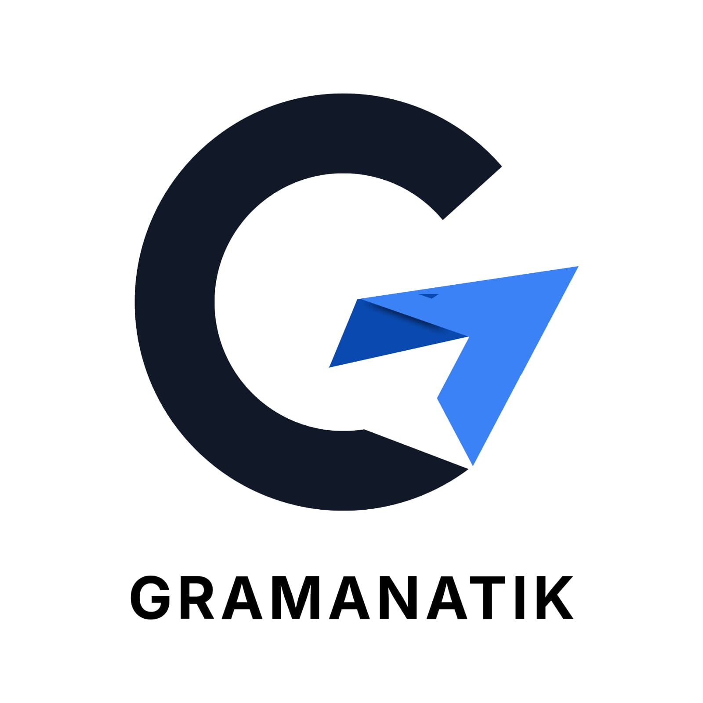

# Gramanatik™

Platform belajar bahasa 

## Kepemilikan / Ownership

© 2026 Zahid Muhammad Kemal. All rights reserved.

Gramanatik digagas dan dikembangkan oleh **Zahid Muhammad Kemal**.
Nama, logo, desain antarmuka, kode sumber, dan konten proyek ini
adalah karya asli pemilik. Domain gramanatik.com didaftarkan
atas nama pemilik. Proyek ini dikerjakan dalam jangka waktu panjang
dan dipublikasikan secara resmi pada tahun 2026.

Gramanatik was conceived and developed by Zahid Muhammad Kemal.
The name, logo, UI design, source code, and content are original
works of the owner. All rights reserved.

## Logo

Logo Gramanatik dibuat sendiri oleh pemilik. Dilarang menggunakan
logo atau nama ini tanpa izin tertulis.

  

File sumber: `assets/logo-gramanatik.svg` (atau format asli desainmu)

Kontak: afluida@gmail.com
